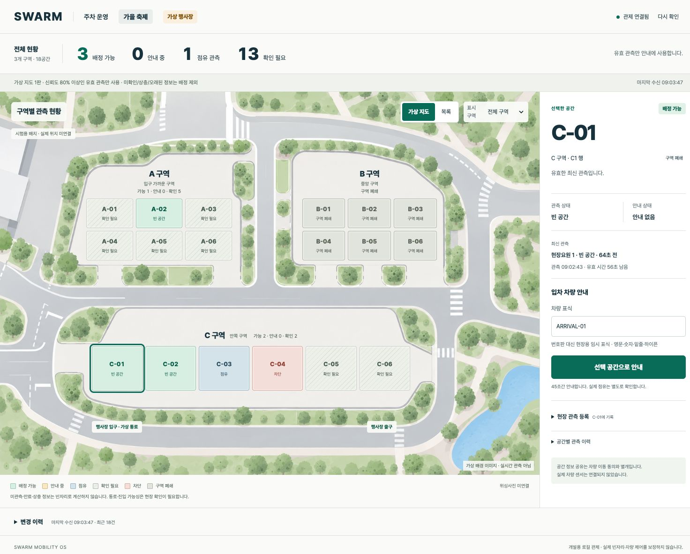
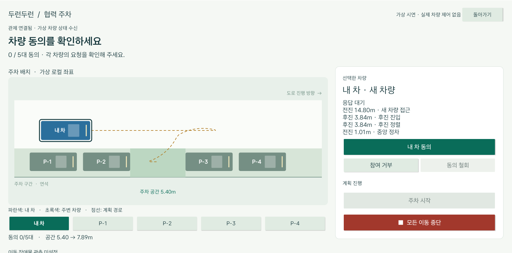

# 두런두런

**서로 통하는 차, 함께 만드는 공간.** 차량들이 이동 의도와 참여 상태를 주고받고 순서대로 움직여 흩어진 빈틈을 모으는 Pleos 차량용 협력 주차 프로젝트입니다.

현대자동차그룹 차량용 앱 개발 공모전 제출 준비를 위한 공개 소스 저장소입니다. 기술 프로젝트명은 Swarm Mobility OS입니다.

## 화면으로 보는 기능

웹 관제는 전체 구역·공간 상태를 살피고 선택 공간을 안내하는 역할, 차량 앱은 이동 요청을 확인하고 동의·협력 주차를 시연하는 역할입니다. 두 화면은 서로 다른 가상 모델이며 실제 주차장을 제어하는 하나의 통합 서비스로 연결하지 않았습니다.

**기존 웹 관제 구현** — 가상 3구역·18공간과 선택 상세 패널의 보존 캡처입니다. 배경은 제작한 가상 그림이며 과거 캡처의 숫자는 현재 운영 실적이 아닙니다.



**차량 앱 UI 개선 후보** — 2026-11-15 개발용 앱에서 직접 실행한 화면입니다. 현재 `apk/`의 서명 release와 루트 Android 소스는 이전 UI를 유지하며, 새 UI의 release는 서명·설치 확인 전입니다.



[상태별 캡처와 지도 출처·화면 역할](docs/screen-guide.md) · [개선 후보 변경분과 검증 범위](docs/ui-candidate/README.md)

## 제출 APK

- 서명된 release: [`apk/redsunjin_두런두런_release.apk`](apk/redsunjin_두런두런_release.apk)
- 체크섬: [`apk/SHA256SUMS`](apk/SHA256SUMS)
- 패키지: `io.swarm.mobility.submission`, 표시명 `두런두런 · 가상시연`
- release build type, `debuggable=false`, RSA 3072 제출 전용 키로 서명. APK Signature Scheme v3 검증 통과.
- 2026-11-15 Pleos Connect 2.1.0 에뮬레이터에 설치 성공, 앱 실행·상시 가상시연 안내·로컬 관제 연결·협력 주차 화면 진입, 4/5 시작 차단, 5/5 시작 후 공간 확보·후진·정렬 완료 확인.

파일 접두어 `redsunjin`은 공개 GitHub 계정 식별자입니다. 개인 참가 신청서의 성명 표기와 파일명 접두어를 맞출 필요가 있으면 최종 접수 전에 변경해야 합니다. 실물 차량 검증은 수행하지 않았습니다. 키와 비밀번호는 공개하지 않습니다.

## 현재 구현

- 가상 차량 크기·상대 자세·이동 한도를 반영한 순차 공간 확보와 평행주차 경로 계산
- Android/Pleos와 로컬 관제의 차량별 요청·동의·진행 표시
- 전원 동의 전 시작 차단, 철회·연결 유실·가상 장애물 위험 중단
- 저장된 배치에서 새 계획·재동의·명시적 시작으로 재개
- 별도 내부 사전 위임·명시적 가상 실행 응답/정지 확인·누적 이동량 원장 및 동적 관측 웹 시험실

별도 내부 실행 모형과 시험실은 기존 Android 시연에 통합하지 않았습니다. 사용자 동의, 가상 실행 응답, 실제 차량 ACK를 구분합니다.

**실제 차량 신원·센서·조향·제동·실차 실행 ACK는 연결하지 않았습니다.** 가상 정지나 경로 검사는 물리 제동 성능·실차 안전성의 증거가 아닙니다. 차량 간 대화는 구조화된 요청/응답이며 자연어 AI 대화나 차량 간 직접 무선 통신을 구현했다는 의미가 아닙니다.

## 테스트 환경과 의존성

- Python 3: 개발 기록은 Python 3.14. Python 부분은 표준 라이브러리 사용
- JDK 17 호환 설정, Gradle 9.4.1 개발 기록, Android Gradle Plugin 8.13.2, Kotlin 2.3.0
- Android compile/target SDK 35, min SDK 28
- Pleos Connect 에뮬레이터 **2.1.0**, API 34 ARM64, 화면 **2560 × 1440**: 과거 개발 검증 환경
- Pleos Vehicle SDK 2.3.2 / FusedLocation 1.1.3 / NaviHelper 3.0.5

Android SDK·Gradle·의존성은 별도로 준비해야 합니다. 저장소에 Gradle wrapper나 SDK/cache, 키, `local.properties`를 넣지 않았습니다. SDK 경로는 로컬 환경에서 지정하세요. 첫 빌드에는 의존성 저장소 접근이 필요합니다. Pleos 개발 환경 사용 조건은 공급자 안내를 따릅니다.

## 장비 없이 재현

저장소 루트에서 실행합니다.

```bash
python3 -m unittest discover -s coordination -t .
python3 -m unittest discover -s simulator -p 'test_*.py'
python3 -m simulator.participation_validation --seeds 20 --output work/participation.json
python3 simulator/curb_replay.py --output work/replay.html
```

생성된 `work/replay.html`을 브라우저에서 열어 협력/이동 없음/거부/중단 사례를 비교합니다. 계산 결과 재생이며 실제 차량을 움직이지 않습니다.

## 로컬 관제와 Android 시연

1. 이 컴퓨터에서 로컬 관제를 실행합니다.

```bash
python3 -m coordination.server --port 8765 --database work/submission-demo.sqlite3
```

2. 서명된 제출 APK를 Android/Pleos 개발 환경에 설치합니다.

```bash
adb -s <EMULATOR_SERIAL> reverse tcp:8765 tcp:8765
adb -s <EMULATOR_SERIAL> install -r apk/redsunjin_두런두런_release.apk
adb -s <EMULATOR_SERIAL> shell am start -n io.swarm.mobility.submission/io.swarm.mobility.MainActivity
```

3. 앱의 협력 평행주차 화면에서 새 계획 → 5대 동의 → 명시적 시작 → 공간 확보·후진·정렬을 확인합니다. 4/5 동의에서는 시작이 막혀야 합니다.
4. 철회·연결 유실·위험 중단 후 위치 보존과 자동 재개 금지, 재계획·새 동의·명시적 재시작을 확인합니다.

제출 프로필은 `http://127.0.0.1:8765`의 로컬 관제 서버가 필요합니다. 외부 서버 주소를 거부하고 지도는 비활성화합니다. 인터넷 서비스나 실제 차량 연결 없이 개발 환경의 가상 차량을 시연합니다.

웹 참여 시험은 `http://127.0.0.1:8765/participate/`에서 진행할 수 있습니다. `/admin/` 지도는 부가 검토 기능이며 실제 주차 현황이 아닙니다. 지도 배경 등 부가 기능은 외부 네트워크를 사용할 수 있습니다.

## release 후보 빌드

서명하지 않는 재현 명령입니다.

```bash
cd android
env -u SWARM_RELEASE_KEYSTORE -u SWARM_RELEASE_KEY_ALIAS \
  -u SWARM_RELEASE_STORE_PASSWORD -u SWARM_RELEASE_KEY_PASSWORD \
  gradle -PpleosEnabled=true -PsubmissionDemo=true \
  :app:assembleRelease :app:testReleaseUnitTest --console=plain
```

Gradle 의존성이 이미 준비된 환경에서는 `--offline`을 추가할 수 있습니다. `submissionDemo=true`일 때만 가상 시연을 활성화합니다. 기본 release의 데모 차단은 유지합니다. 서명 키와 비밀번호는 저장소에 넣지 않습니다.

## 검증 기록

2026-11-15 개발 트랙 기록: 관제201/201, 주차계산70/70, 참여 프로토콜201/201, 제출 release JVM64/64 통과. 서로 다른 검사 집계를 합쳐 실차 성공률로 표현하지 않습니다. 이번 서명본의 설치·UI 확인 범위는 위 APK 항목과 `VALIDATION.md`를 참조하세요. 소스 파일과 후보 APK의 SHA-256은 `SOURCE-MANIFEST.json`에 기록합니다.

## 시연 영상

[2분 40초 영상 초안](media/dureondureon-demo-draft.mp4): 자막 포함 무음, 계산 결과 재생과 설명 카드로 구성했습니다. 새 release 후보 실행을 촬영한 영상은 아닙니다. 제작 시점 이후의 새 기능은 담겨 있지 않습니다. 최종 제출 전 문구와 전체 재생을 확인해야 합니다.

## 향후 방향

차주 부재 중 사전 위임과 차량별 응답을 토대로 협력 재배치·출차 보호·차량 부담을 검증합니다. 예약·시간표·주차관리/자율주행 연동은 개념 단계입니다. 시설·차량·앱이 도착·주차 작업·체류/희망 출차·회수/인계 일정을 교환하는 구상이며, 실제 공급자/API/시설 연동과 시간 정확도·효율 효과는 미검증입니다. 예약이나 예상 시각은 이동 권한·실제 완료·빈자리를 대신하지 않습니다.

## 공개 범위와 권리

공식 신청서·동의서·성명/연락처·본인 서명·로컬 설정·실행 DB·참여 토큰·서명 키는 포함하지 않습니다. Leaflet 배포물의 LICENSE를 원본과 함께 보존합니다. 지도 출처와 기타 SDK/의존성의 이용조건은 각 공급자의 조건을 따릅니다. 공개 열람이 코드/자산에 새 오픈소스 라이선스를 부여한다는 뜻은 아닙니다.
