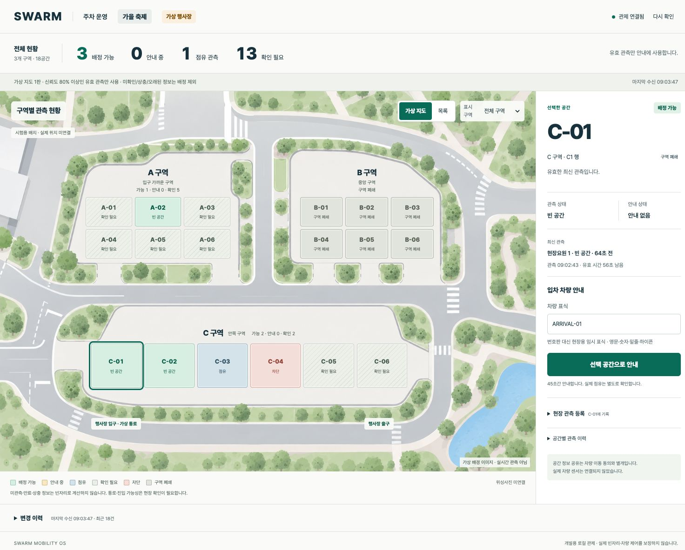
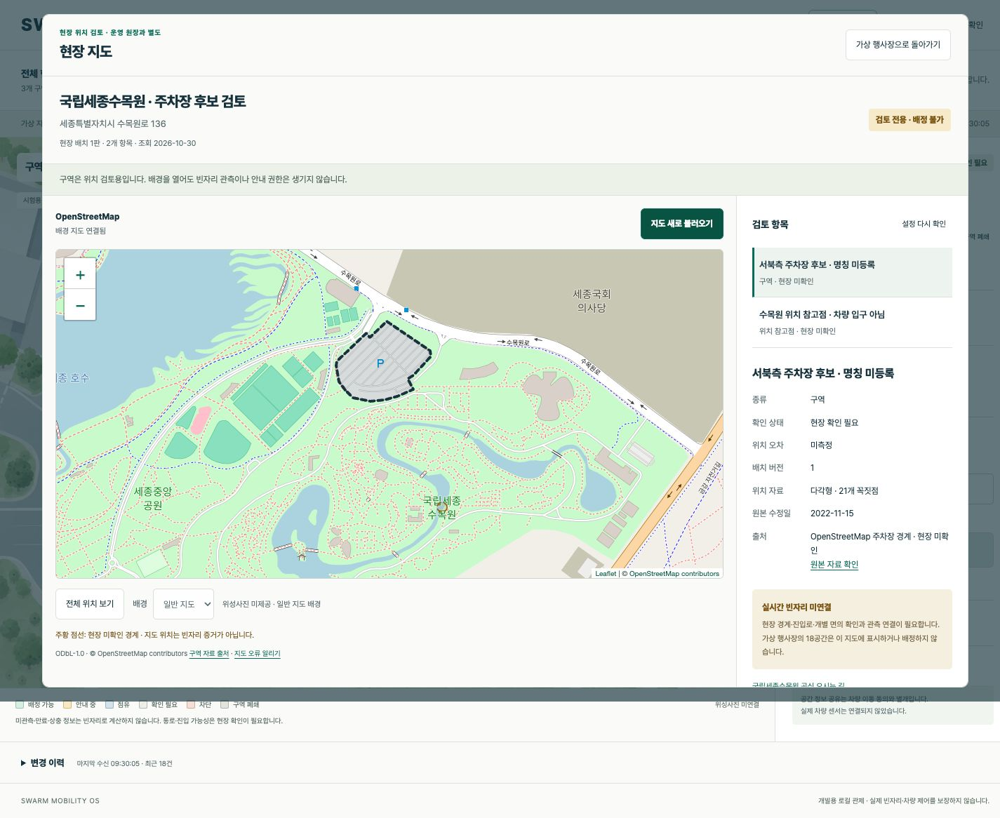
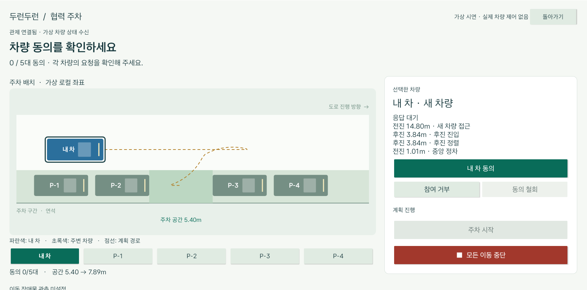
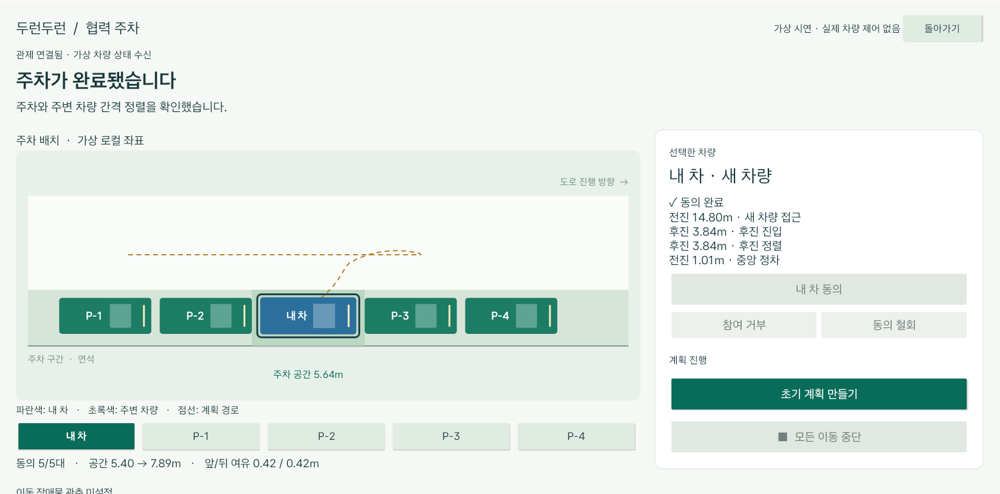

# 화면으로 보는 두런두런

두런두런은 운영자가 공간 상태를 살피는 웹 관제와 차량의 이동 요청을 확인하는 앱을 개발하고 있습니다. 아래 화면은 구현된 기능과 검증 범위를 설명하는 자료입니다. 웹의 전체 주차장 배치와 앱의 차량별 협력 주차는 서로 다른 가상 모델이며, 화면 간 자동 전환이나 실제 주차장 제어로 통합하지 않았습니다.

## 화면과 실행본 구분

| 자료 | 보여주는 역할 | 현재 상태 |
| --- | --- | --- |
| 웹 관제 | A/B/C 구역·공간 상태, 선택 공간 확인과 임시 안내 | 기존 구현의 보존 캡처 |
| OSM 현장 지도 | 실제 위치와 후보 경계·접속 관계 검토 | 현장 미확인·실시간 점유 미연결 |
| 개선 앱 UI | 큰 차량 배치, 선택 차량과 주요 조작, 동의·진행·중단 | 개발용 앱 직접 실행, 서명 release 설치 전 |
| `apk/`의 제출 파일 | 협력 주차 실행과 동의·완료 확인 | 이전 UI의 서명 release 유지 |

## 전체 주차장 운영 상황

2026-10-30 구현 검증 당시의 웹 관제 화면입니다. 3구역·18공간의 가상 배치에서 관측 상태와 안내 상태를 나누고, 오른쪽 선택 공간 패널에서 정보를 확인하고 안내합니다. 캡처의 숫자·연결 상태·관측 시각은 과거 시험 순간의 값이며 현재 운영 실적이 아닙니다.

밝은 배경은 Image Gen으로 제작한 가상 배치 그림입니다. 실제 시설 사진·위성영상·센서 관측이 아닙니다. 배경 위의 공간 ID·상태·선택 표시·요약 수치·안내 동작은 별도의 화면 요소로 구현했습니다. 지도와 관측 이력을 보여 준다는 사실만으로 차량 이동 권한을 얻는 것은 아닙니다. 배경 제작과 구현 검증은 개발 기록 `design-qa.md`의 2026-10-30 항목에 근거합니다.

## 실제 위치 검토

기존 OSM 위치 검토 캡처입니다. 출처가 있는 후보 경계와 주변 도로 관계를 확인하는 용도이며, 현장 측량·주차면 정합·실시간 빈자리·출입 가능 여부는 확인하지 않았습니다. 가상 18공간을 이 지도 위의 실제 공간으로 대응시키지 않았습니다. 화면의 Leaflet 및 © OpenStreetMap contributors 표기를 유지합니다. [OSM 저작권과 ODbL](https://www.openstreetmap.org/copyright), [후보 경계 원본](https://www.openstreetmap.org/way/1113205038).

## 차량별 요청 확인과 협력 주차

다음은 2026-11-15 개선한 개발용 앱의 실제 Pleos 에뮬레이터 캡처입니다. 일반 지리 지도가 아닌 가상 로컬 좌표 배치이며, **현재 다운로드 가능한 서명 APK에는 이 새 UI가 들어 있지 않습니다.** 문서용 확대본은 원본에서 앱 영역만 잘랐고 화면 내용은 바꾸지 않았습니다.

내 차와 주변 차량, 계획 경로를 크게 보고 선택 차량의 이동 방향·거리와 참여 요청을 확인합니다. 다른 차량의 응답은 시험용 패널에서 대신 입력하는 시연입니다.

전원 동의 후 사용자가 시작해야 진행합니다. 완료 화면의 앞뒤 여유 0.42m/0.42m는 특정 가상 사례의 값이며 실차 측정값이 아닙니다. 공간 확보 때의 최대 빈틈 7.89m와 주차 후 간격 재정렬을 마친 화면의 공간 길이는 서로 다른 시점입니다.

### 상태별 원본 캡처

| 상태 | 확인할 내용 | 원본 |
| --- | --- | --- |
| 동의 대기 | 0/5 응답과 시작 비활성 | [02](../media/screens/02-awaiting.png) |
| 시작 준비 | 5/5 동의 후 별도 시작 요구 | [03](../media/screens/03-ready.png) |
| 공간 확보 중 | 현재 이동 차량과 전체 중단 동작 | [04](../media/screens/04-running.png) |
| 중단 | 중단 사유와 현재 위치 재계획 | [05](../media/screens/05-stopped.png) |
| 완료 | 주차·간격 정렬 상태와 앞뒤 여유 | [06](../media/screens/06-completed.png) |
| 재동의 | 현재 배치에서 새 동의와 시작 차단 | [07](../media/screens/07-reconsent.png) |
| 연결 끊김 | 마지막 수신 배치, 최신 상태 확인 요구 | [08](../media/screens/08-disconnected.png) |

[UI 변경분과 검증 기록](ui-candidate/README.md)을 함께 제공합니다. 개발용/제출용 자동 검사 각 64개 통과와 개발용 앱 직접 실행 확인을 구분했습니다. 새 release의 서명·설치, 공개 APK 교체와 시연 영상 갱신은 아직 수행하지 않았습니다.

## 서비스 사용 흐름의 목표

전체 배치에서 구역 상황 확인 → 선택 공간 확인·안내 → 차량별 이동 요청 확인·동의 → 협력 주차의 흐름을 목표로 합니다. 현재 웹과 앱 사이에 이 전환이나 제어 흐름이 완성돼 있다는 뜻은 아닙니다. 시설·차량·앱의 예약과 시간표 교환도 향후 구상으로 유지합니다.
